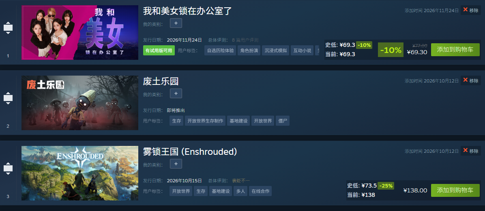
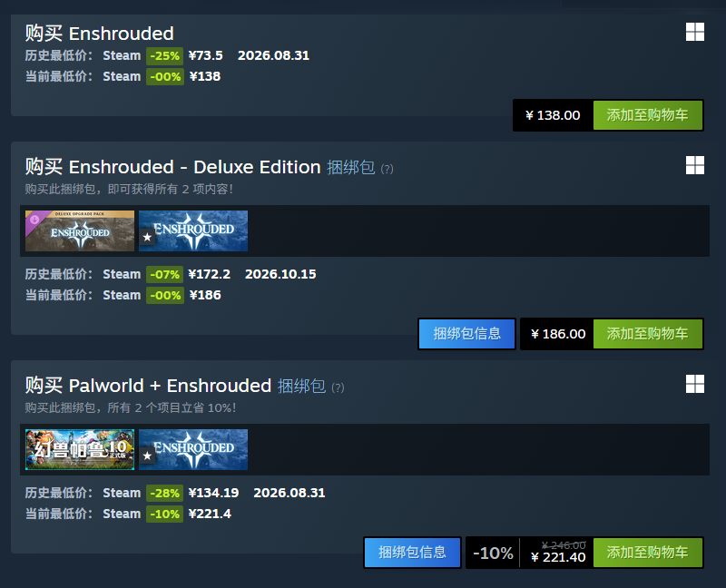

# Steam游戏历史最低价格

<p align="center">
  
</p>

<p align="center"><b>在 Steam 商店页与愿望单里，直接看到「历史最低价 + 当前最低价」</b></p>

<p align="center">
  <code>版本 1.3.0</code> · <code>MIT 许可</code> · <code>Tampermonkey / Violentmonkey</code> · <code>货币跟随商店地区</code>
</p>

一个轻量的用户脚本：不打开第三方比价站，在 Steam 自己的页面上就能判断「现在值不值得买」。
只统计 **Steam 商店渠道** 的价格，货币跟随你的商店地区。

---

## 功能

**商店页（`store.steampowered.com/app/*`）**
- 每个「购买」区块内追加两行小字：历史最低价（含日期、渠道、折扣、价格）与当前最低价
- 本体、Deluxe Edition、捆绑包分别取价，捆绑包不会被平均价糊住
- 自动跳过「下载 Demo」「请求访问权限」等没有价格意义的区块

**愿望单（`store.steampowered.com/wishlist/*`）**
- 每行在价格左侧显示「史低 / 当前」，左对齐、与「添加购物车」同一行
- 配色、字号、字距与商店页完全一致
- 滚动加载、窗口缩放、Steam 重建列表行都会自动补画

**通用**
- 价格数据本地缓存 6 小时，避免每次刷新都打接口
- 多镜像核对更新，发现新版在右下角提示
- 零依赖，单文件，纯原生 JS

---

## 效果图

**愿望单**（账号信息已打码）



**商店页**（本体 / Deluxe Edition / 捆绑包三处都有）



---

## 安装

1. 先装脚本管理器：[Tampermonkey](https://www.tampermonkey.net/) 或 Violentmonkey
2. 打开 [Releases](https://github.com/ZzicoChen/Steam-SD/releases/latest)，点 **`Steam-SD.Install.user.js`** —— 会直接弹出油猴安装页，点「安装」即可
3. 想自己看代码的：下载 **`Steam-SD.js`**（普通文本，不触发安装），复制全文到脚本管理器里新建脚本

> 两个附件的区别：`Steam-SD.Install.user.js` 结尾是 `.user.js`，浏览器/油猴识别为脚本并弹安装页；`Steam-SD.js` 只是源码文件，点了就是普通下载。

安装完打开任意游戏页或愿望单，几秒内出现史低信息（首次要请求价格接口）。

---

## 更新

| 入口 | 地址 | 说明 |
| --- | --- | --- |
| 主（脚本头部 `@updateURL`） | `https://ghfast.top/https://raw.githubusercontent.com/ZzicoChen/Steam-SD/main/Steam-SD.js` | 加速直取 raw，**不缓存**，拉到的就是最新 |
| 原地址 | `https://raw.githubusercontent.com/ZzicoChen/Steam-SD/main/Steam-SD.js` | GitHub 真正的源头，国内可能无法直连 |
| 兜底 | `https://cdn.jsdelivr.net/gh/ZzicoChen/Steam-SD@main/Steam-SD.js` | jsDelivr 的 `@main` 有约 12 小时缓存，可能滞后 |

- 脚本每 6 小时核对一次（`ghfast → raw → jsDelivr` 依次尝试），有新版本在右下角提示「点此安装」
- 头部只能写一条 `@updateURL`，其余两条以注释形式保留在脚本里，方便自行切换
- 手动更新：下载新版 `Steam-SD.Install.user.js` 覆盖即可，配置（缓存）不会丢

---

## 配色与排版规范

| 元素 | 颜色 | 备注 |
| --- | --- | --- |
| 中文说明（史低 / 当前 / 时在…） | `#aebbc7` | 浅灰，和数字区分 |
| 价格数字 | `#ffffff` | 纯白；愿望单不加粗，避免抢视线 |
| 折扣百分比 | 字 `#c9f22f`、底 `#4c6b22` | 胶囊：圆角 2px、padding 0 4px、12.5px |
| 日期 | `#ffffff` | 与价格同色，同级信息 |
| 渠道名 Steam | `#cfdae3` | 比正文略亮 |
| 字号 / 行高 / 字距 | `13.5px / 1.7 / 0.2px` | 商店页与愿望单一致 |
| 字族 | `"Motiva Sans", Arial, sans-serif` | 贴合 Steam 原生观感 |

---

## 数据来源与价格口径

| 用途 | 接口 | 说明 |
| --- | --- | --- |
| 现价 | Steam `store.steampowered.com` GetItems | appid + 地区，拿当前价与折扣 |
| 史低 | AugmentedSteam `prices/v2` | 限定 `shops: [61]`，即只取 Steam 渠道 |
| 兜底 | 小黑盒 `history/v2` | AugmentedSteam 无数据时补 |
| 缓存 | `GM_setValue`，key `shcAppLow:v3:*` | 6 小时内命中本地缓存 |

- 只显示 **Steam 商店** 的历史最低价，不合并第三方平台（Humble、Fanatical 等）
- 货币随商店地区，国区即 CNY；跨区价格会不同
- 「-0%」表示当前不是折扣价，即原价购买

---

## 版本演进

| 版本 | 主要变化 |
| --- | --- |
| v1.0.0 | 首个版本：商店页显示「史低 + 当前」两行（当时内部编号 1.1，为补齐序列按 v1.0.0 发布） |
| v1.0.1 | 脚本更名为「Steam游戏历史最低价格」，版本号规范化 |
| v1.0.2 | 评估 SteamDB 作为数据源（结论：不适合直接抓取，无代码变更） |
| v1.0.3 | 新增脚本图标（首个版本，走 jsDelivr SVG） |
| v1.0.4 | 图标换成 Steam 官方标志（未能生效） |
| v1.0.5 | 图标改为单一 SVG 源（未能生效） |
| v1.0.6 | 图标改走 raw.githubusercontent（未能生效） |
| v1.0.7 | 定位到根因：脚本管理器抓图标只认 `cdn.jsdelivr.net` |
| v1.0.8 | 图标内嵌 base64，首次上传 GitHub（含 README、MIT 许可证） |
| v1.0.9 | 新增愿望单每行显示史低与当前价 |
| v1.1.0 | 修复新版愿望单不显示：行结构改为 `div.Panel[data-index]`，插入点改到 `gridArea=purchase` 的价格格 |
| v1.1.1 | 新增多镜像自动更新核对与右下角更新提示 |
| v1.1.2 | 愿望单史低块左对齐，贴到价格行左侧（与参考效果一致） |
| v1.1.3 | 文字提亮加粗：浅亮色、`font-weight:700`、字号上调 |
| v1.1.4 | 配色分层：中文浅灰 / 价格纯白 / 日期浅蓝 |
| v1.1.5 | 更新源改为 ghfast 直取 raw——jsDelivr `@main` 缓存导致长期收不到新版 |
| v1.1.6 | 日期改纯蓝、愿望单与商店页配色/字号/字距统一、折扣加胶囊底色、安装件改 `.user.js` |
| v1.1.7 | 日期改用与价格相同的纯白，愿望单价格数字取消加粗，折扣维持胶囊原样 |
| v1.1.8 | 修复部分区块只显示一行：接口缺当前价时改读区块自身价格（本体 / Deluxe / 捆绑包全部兜底），缓存升到 v4 |
| v1.1.9 | 缺数据的那一行用灰色「暂无记录」占位，史低 / 当前两行无条件都画；无折扣时不再出现 -0% 胶囊 |
| v1.2.0 | 查不到史低但当前正在打折时，用当前价顶替史低（不再只剩一行）；仅「无史低 + 无折扣」保留灰色「暂无记录」 |
| v1.2.1 | 游戏页无折扣时也画 -0% 胶囊，史低 / 当前两行视觉统一（愿望单不变） |
| v1.3.0 | 修缓存失效与 observer 自触发，兜底请求并发化，先画后补：商店页首绘 4.4s → 8ms，愿望单首行 4.9s → 91ms |

> 说明：v1.0.0–v1.0.3 与 v1.0.5–v1.0.7 当时只存在于本地，未进仓库；这几个 Release 的附件取的是最接近的可追溯快照（`@version` 分别为 1.0.4 / 1.0.8）。

---

## 常见问题

**页面上没有出现史低信息？**
- 确认地址是 `/app/…` 或 `/wishlist/…`，其他页面脚本不生效
- 第一次打开要请求价格接口，通常 1–3 秒后出现；期间不要重复刷新
- 若被广告拦截/隐私插件挡住 `api.augmentedsteam.com`、`api.xiaoheihe.cn`、`store.steampowered.com`，需放行

**为什么有的游戏只有「当前」没有「史低」？**
- 该 appid 在 Steam 渠道没有历史价格记录（新上架、从未打折、或区域下架）

**更新提示一直不出现？**
- 老版本可能卡在 jsDelivr 缓存里，手动装一次最新 `Steam-SD.Install.user.js` 即可，之后走 ghfast 即时更新

**捆绑包价格和里面单个游戏加起来不一样？**
- 捆绑包按自身售卖价取史低，不对子项求和，这是 Steam 的计价方式

---

## 目录结构

```
Steam-SD.js                 主脚本（LF，Release 直接下载件）
README.md                   本文件
LICENSE                     MIT
assets/steam.svg            首页图标
wishlist.png                愿望单效果图（账号已打码）
store.png                   商店页效果图（好友头像已打码）
```

---

## 许可与致谢

- 以 MIT 许可证发布，作者 beerlee，可自由修改与再分发，保留署名即可
- 愿望单新版 DOM 的适配思路参考了同类脚本 Steam Wishlist Enhancer（同样采用「行容器 + 价格格」的定位方式），代码为本项目独立实现
- 价格数据来自 Steam 官方接口与 AugmentedSteam，版权归各来源所有；本项目仅做展示，不提供买卖建议
